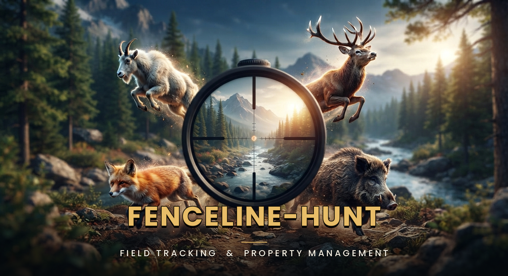

# Fenceline-Hunt — Releases

Official release mirror for **Fenceline-Hunt**, the offline fenceline mapping app for Android.

  

## Download

The newest version is always the **top entry on the [Releases page](../../releases)** —
open that page on your Android phone and tap the `.apk` to install. Every version
keeps its own release notes there.

For a quick overview of the app — what it does, how to install it and how licensing
works — see the **[Fenceline-Hunt site](https://ruddy19.github.io/Fenceline-Hunt-Releases/)**.

Install: download the APK on your Android device and open it. The first time,
Android asks you to allow installing apps from this source — tap **Settings** on
that prompt, switch on **Allow from this source**, then go back and tap **Install**.

> If Google Play Protect shows an "App scan recommended" step, let the scan finish
> before retrying — a timed-out scan can report "App not installed".

## Earlier versions

The newest release is always the one the app updates to. Every release keeps its
APK, notes and user guide on the [Releases page](../../releases) — these earlier
builds stay there for rolling back or reinstalling:

| Version | Release |
| --- | --- |
| v1.3.59 | [v1.3.59 — The wind, before it changes](../../releases/tag/v1.3.59) |
| v1.3.58 | [v1.3.58 — Wind, gloves and hills](../../releases/tag/v1.3.58) |
| v1.3.57 | [v1.3.57 — Updates you can trust](../../releases/tag/v1.3.57) |
| v1.3.52 | [v1.3.52 — the record button is the trial door](../../releases/tag/v1.3.52) |
| v1.3.51 | [v1.3.51 — A straight 3-use trial and safer field data](../../releases/tag/v1.3.51) |
| v1.3.50 | [v1.3.50 — Imported KMLs keep their shapes and red exclusion zones](../../releases/tag/v1.3.50) |
| v1.3.47 | [v1.3.47 — Property Manager rebuilt as a tile hub, and recorded boundaries that stay on the road](../../releases/tag/v1.3.47) |
| v1.3.46 | [v1.3.46 — Satellite by default, a clearer stationary threshold, and a viewable offline reminder](../../releases/tag/v1.3.46) |
| v1.3.45 | [v1.3.45 — the cull-species information pop-up is now tabbed](../../releases/tag/v1.3.45) |
| v1.3.44 | [v1.3.44 — the trip review reports the land its fenceline holds](../../releases/tag/v1.3.44) |
| v1.3.42 | [1.3.42 — the fenceline names itself, and the map finds your work](../../releases/tag/v1.3.42) |
| v1.3.41 | [1.3.41 — the map finds you even without a GPS fix](../../releases/tag/v1.3.41) |
| v1.3.39 | [1.3.39 — no crash on launch, smoother screens, and a Back that behaves](../../releases/tag/v1.3.39) |
| v1.3.37 | [1.3.37 — saved-trip map fix and cleaner help popups](../../releases/tag/v1.3.37) |
| v1.3.36 | [1.3.36 — simpler Drive/Walk fenceline creation](../../releases/tag/v1.3.36) |
| v1.3.35 | [1.3.35 — update-check diagnostics](../../releases/tag/v1.3.35) |
| v1.3.34 | [1.3.34 — fix the in-app installer crash](../../releases/tag/v1.3.34) |
| v1.3.33 | [1.3.33 — feature pins, per-name cull deletes & field fixes](../../releases/tag/v1.3.33) |
| v1.3.32 | [1.3.32 — quieter release builds](../../releases/tag/v1.3.32) |
| v1.3.31 | [1.3.31 — cull species management, clean snapshots](../../releases/tag/v1.3.31) |
| v1.3.30 | [1.3.30 — Drive/Walk two-stage capture](../../releases/tag/v1.3.30) |
| v1.3.29 | [v1.3.29 - Drive/Walk becomes the full Draw Fenceline editor](../../releases/tag/v1.3.29) |
| v1.3.28 | [v1.3.28 - Drive/Walk opens at your location, not all of Australia](../../releases/tag/v1.3.28) |
| v1.3.27 | [v1.3.27 - GPS button clears the zoom-out button on phones](../../releases/tag/v1.3.27) |
| v1.3.26 | [v1.3.26 - Draw Fenceline leads the Fenceline Maps button row](../../releases/tag/v1.3.26) |
| v1.3.25 | [v1.3.25 - Drive/Walk Fenceline returns to Fenceline Maps](../../releases/tag/v1.3.25) |
| v1.3.23 | [v1.3.23 - Phone landscape lock, auto-hiding bars and small-screen fixes](../../releases/tag/v1.3.23) |
| v1.3.17 | [v1.3.17 - Buyer names in the license ledger](../../releases/tag/v1.3.17) |
| v1.3.16 | [v1.3.16 - Phone-based license administration](../../releases/tag/v1.3.16) |
| v1.3.15 | [v1.3.15 - Online license revocation](../../releases/tag/v1.3.15) |
| v1.3.14 | [v1.3.14 - Offline fencelines, UI polish](../../releases/tag/v1.3.14) |
| v1.3.13 | [v1.3.13 - License keys locked to buyer email](../../releases/tag/v1.3.13) |
| v1.3.12 | [v1.3.12 - Update integrity checks](../../releases/tag/v1.3.12) |
| v1.3.11 | [v1.3.11 - Video splash screen](../../releases/tag/v1.3.11) |
| v1.3.10 | [v1.3.10 — How-to-buy section and dedicated contact email](../../releases/tag/v1.3.10) |
| v1.3.9 | [v1.3.9 — Feature-pin menu and menu-recovery fixes](../../releases/tag/v1.3.9) |
| v1.3.8 | [v1.3.8 — Offline-basemap navigation fixes](../../releases/tag/v1.3.8) |

## User guide

**[Fenceline-Hunt User Guide (PDF)](../../releases/latest/download/Fenceline-Hunt-User-Guide.pdf)**
— how to record a trip, draw or record a fenceline, log culls, use offline basemaps,
and every setting explained.

That link always serves the guide attached to the newest release, so it stays in step
with the version you are running. It is also listed as a file on each release page.

## Updates inside the app

The app checks this mirror automatically — open **Menu → Settings → Software Update
→ Check for Updates**, or tap the update banner on launch. An update installs over
the top and keeps every saved map, fenceline, trip and cull log.

## Licensing

- **Free to try:** 3 trips — each trip you start uses one of the three, however
  short it is; discard it and the use comes back. Drawing, importing and editing
  fencelines is free and unlimited, and opening a saved map never spends a use.
  Once all three are used, recording trips, capturing offline basemaps, opening
  your saved fenceline or offline maps, and exporting recorded trips need a
  licence; the live map, the cull log and your trip history keep working, and
  fencelines always export to KML.
- **A licence is $29.95, one-off.** The key does not expire. To buy it, email
  **fenceline.hunt@gmail.com** (card, PayPal or bank transfer) and the key comes
  back by email, or use **Menu → Settings → License → "How to buy a key"** in the app.
- A licence key is issued to a specific email address, and verification is fully
  offline; an internet connection is needed only the first time a key is validated.

## Source

The application source is maintained in a **private** repository. This mirror is the
public distribution channel and holds release artifacts only.
