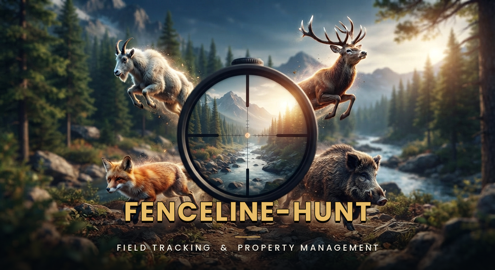

# Fenceline-Hunt — Releases

Official release mirror for **Fenceline-Hunt**, the offline fenceline mapping app for Android.

  

## Download

The newest version is always the **top entry on the [Releases page](../../releases)** —
open that page on your Android phone and tap the `.apk` to install. Every version
keeps its own release notes there.

For a quick overview of the app — what it does, how to install it and how licensing
works — see the **[Fenceline-Hunt site](https://ruddy19.github.io/Fenceline-Hunt-Releases/)**.

Install: download the APK on your Android device and open it. The first time,
Android asks you to allow installing apps from this source — tap **Settings** on
that prompt, switch on **Allow from this source**, then go back and tap **Install**.

> If Google Play Protect shows an "App scan recommended" step, let the scan finish
> before retrying — a timed-out scan can report "App not installed".

## User guide

**[Fenceline-Hunt User Guide (PDF)](../../releases/latest/download/Fenceline-Hunt-User-Guide.pdf)**
— how to record a trip, draw or record a fenceline, log culls, use offline basemaps,
and every setting explained.

That link always serves the guide attached to the newest release, so it stays in step
with the version you are running. It is also listed as a file on each release page.

## Updates inside the app

The app checks this mirror automatically — open **Menu → Settings → Software Update
→ Check for Updates**, or tap the update banner on launch. An update installs over
the top and keeps every saved map, fenceline, trip and cull log.

## Licensing

- **Free to try:** 3 trips — each trip you start uses one of the three, however
  short it is; discard it and the use comes back. Drawing, importing and editing
  fencelines is free and unlimited, and opening a saved map never spends a use.
  Once all three are used, recording trips, capturing offline basemaps, opening
  your saved fenceline or offline maps, and exporting recorded trips need a
  licence; the live map, the cull log and your trip history keep working, and
  fencelines always export to KML.
- **A licence is $29.95, one-off.** The key does not expire. To buy it, email
  **fenceline.hunt@gmail.com** (card, PayPal or bank transfer) and the key comes
  back by email, or use **Menu → Settings → License → "How to buy a key"** in the app.
- A licence key is issued to a specific email address, and verification is fully
  offline; an internet connection is needed only the first time a key is validated.

## Source

The application source is maintained in a **private** repository. This mirror is the
public distribution channel and holds release artifacts only.
